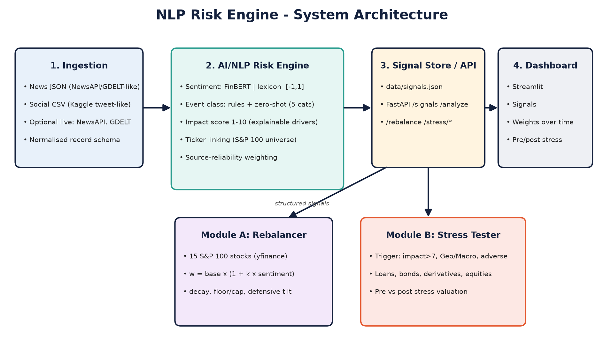

# NLP Risk Engine: Unstructured Text to Financial Risk Signals - S&P Global & Crisil Campus Hackathon

**Candidate Name:** Anshu Yadav
**College Email ID:** annuanshu2005@gmail.com
**College / Campus:** Indira Gandhi Delhi Technical University for Women, New Delhi
**Demo Video Link:** (https://youtu.be/aegp-ecgpSk)
**Slide Deck Link (if hosted externally):** Not needed - deck is in this repo at [`docs/presentation.pdf`](docs/presentation.pdf)

## 1. Project Overview / Problem Statement & Approach

Market-moving information arrives as unstructured text (news headlines, social posts) far faster than people can read, score and act on it. This project builds a **unified AI/NLP Risk Engine** that ingests text from **two sources** (news JSON + social-media CSV; optional live NewsAPI / GDELT) and converts every item into a structured, machine-readable signal:

| Field | Meaning |
|---|---|
| `sentiment_score` | continuous, -1.0 (extreme negative) to +1.0 (extreme positive) |
| `event_category` | Geopolitical, Macroeconomic, Credit Event, Merger/Acquisition, Product Launch (or Other) |
| `impact_score` | predicted market severity, 1 (negligible) to 10 (systemic), shipped with its explainable `drivers` |
| `tickers`, `scope` | S&P 100 entities mentioned; `company` vs `market`-wide |

Signals are served via **FastAPI** and written to `data/signals.json`. **Both** downstream modules are implemented:

* **Module A - Tactical Index Rebalancing:** 15 S&P 100 stocks; weights tilt up on positive and down on negative sentiment (`w = base x (1 + k x sentiment)`, exponential memory, floor/cap, defensive-sector tilt on market-wide stress); interactive weights-over-time dashboard.
* **Module B - Strategic Stress Testing:** a synthetic wholesale-banking book (loans, corporate bonds, derivatives, equities). When an event has **impact > 7**, category **Geopolitical or Macroeconomic** and adverse sentiment, a stress scenario (e.g. -10% equities, +200 bp rates) is applied automatically; the dashboard shows pre- vs post-stress values.

## 2. Architecture & Tech Stack



```
Ingestion (news JSON, tweets CSV, optional NewsAPI/GDELT)
   -> NLP Risk Engine (sentiment | event classifier | impact | ticker linking)
   -> Signal store (data/signals.json) + REST API (FastAPI)
        -> Module A: SentimentRebalancer  -> Streamlit dashboard
        -> Module B: StressTester         -> Streamlit dashboard
```

* **Python 3.10+**, FastAPI + Uvicorn, Streamlit + Plotly, pandas/numpy, yfinance, pytest.
* **Sentiment:** finance-tuned lexicon with negation/phrase handling (default: instant, offline, no downloads) **or FinBERT** (`ProsusAI/finbert`, opt-in).
* **Event classification:** weighted keyword rules with BART zero-shot fallback (opt-in with FinBERT backend).
* **Impact score:** transparent additive model (category base + severity keywords + |sentiment| + market-wide scope, x0.9 for lower-reliability social sources).
* Repo layout: `src/ingestion`, `src/nlp_engine`, `src/modules`, `src/api.py` (REST), `src/app.py` (dashboard), `scripts/`, `tests/`.

## 3. Dataset Used

**Everything in `/data` is synthetic - no real, proprietary, or S&P Global / Crisil data is used.** Generated reproducibly (seed 42) by `scripts/generate_data.py`:

| File | Content |
|---|---|
| `sample_news.json` | 62 synthetic news headlines (source 1), 12 trading days, 15 tickers + market-wide events |
| `sample_tweets.csv` | 90 synthetic tweets (source 2), Kaggle-tweet-like columns |
| `prices_sample.csv` | synthetic daily closes - **offline fallback** when yfinance is unavailable |
| `portfolio_mock.json` | synthetic bank book: 8 loans, 6 bonds, 5 derivatives, 6 equity positions (~$1.4bn) |
| `eval_heldout.json` | 30 hand-written headlines with gold labels for honest evaluation |
| `signals.json` | engine output (regenerate with `python scripts/run_pipeline.py`) |

Assumptions: gold labels in the sample files are only used by `scripts/evaluate.py` (never by the engine); synthetic prices contain scripted market-wide drops on days following the scripted geopolitical/rate-shock headlines but are otherwise independent of ticker-level news. Public sources it plugs into: NewsAPI, GDELT (live fetchers in `src/ingestion/live_fetchers.py`), Kaggle financial-news / tweet-sentiment datasets (drop a CSV with `tweet_id, created_at, user, text` columns into `data/` and point `TWEETS_FILE` to it), Yahoo Finance via yfinance.

## 4. Quickstart & Installation

Runtime: **Python 3.10+ (tested on 3.12)** on **Linux** (pure Python; also works on macOS/Windows).

```bash
git clone <your-repo-url>
cd <repo-folder>
python -m venv .venv && source .venv/bin/activate      # Windows: .venv\Scripts\activate
pip install -r requirements.txt
streamlit run src/app.py                                # dashboard at http://localhost:8501
```

Other commands:

```bash
uvicorn src.api:app --reload          # REST API + Swagger UI at http://127.0.0.1:8000/docs
python scripts/run_pipeline.py        # re-score both sources -> data/signals.json
python scripts/evaluate.py            # accuracy on labelled sets
python -m pytest -q                   # 13 unit/integration tests
python scripts/generate_data.py       # regenerate synthetic data
python scripts/make_docs.py --name "..." --college "..." --email "..."   # rebuild deck + diagram
```

Optional FinBERT / zero-shot backend (about 2 GB download, needs internet):
```bash
pip install -r requirements-ml.txt
NLP_BACKEND=finbert streamlit run src/app.py        # Windows: set NLP_BACKEND=finbert
```
Optional live news: `export NEWSAPI_KEY=...` (NewsAPI) - GDELT needs no key (dashboard "Signals" tab). Optional live prices: tick the sidebar checkbox. If any live source fails, the app falls back to bundled offline data.

API examples:
```bash
curl -X POST localhost:8000/analyze -H 'Content-Type: application/json' \
  -d '{"text":"Central bank shocks markets with surprise rate hike","source_type":"news"}'
curl "localhost:8000/signals?category=Geopolitical&min_impact=7"
curl localhost:8000/stress/events ; curl localhost:8000/rebalance
```

## 5. Key Results & Domain Impact

**What it demonstrates** (bundled data): 152 texts from 2 sources scored in ~0.05 s on CPU; 10 stress events triggered (corroborating news + tweets clustered); worst case about -12.9% of book value (Macroeconomic, +200 bp), Geopolitical about -7.0%; rebalancer weights always sum to 100% within floor/cap bounds (unit-tested).

**NLP accuracy - read this honestly:**

| Set | Sentiment | Category |
|---|---|---|
| Bundled synthetic (template-generated) | 100% | 100% - *not meaningful, labels share the generator* |
| Held-out hand-written (n=30), **first run, untouched** | 56.7% | 76.7% |
| Same set after I broadened the lexicon with general finance vocabulary | 86.7% | 96.7% - *the set is now a dev set, so this is optimistic* |

The lexicon backend is a fast, explainable baseline; for production-grade accuracy use the FinBERT backend and validate on a larger independent set (e.g. Financial PhraseBank / Kaggle financial-news sentiment).

**Why it matters:** asset managers get bounded, auditable tilts instead of ad-hoc reactions; risk officers get event-triggered stress runs with pre/post valuation by asset class within seconds; every score carries its drivers for audit. Limitations: synthetic data, heuristic (uncalibrated) impact score, simplified parallel-shift stress model - see slide 7.

Design choices to mention in the pitch: adverse-sentiment condition on triggers (a ceasefire rally is high-impact but not a stress event); event clustering to avoid duplicate stress runs; weights at close of day *t* earn day *t+1* returns (no look-ahead).